<!-- Header -->
<p align="center">
  
</p>

<p align="center">
  <a href="https://github.com/launathiel">
    
  </a>
</p>

<p align="center">
  <a href="https://linkedin.com/in/launathiel/"></a>
  <a href="mailto:launathiel@gmail.com"></a>
  <a href="https://twitter.com/LauNathiel"></a>
  <a href="https://discord.com/users/437256188074131476"></a>
  
</p>

---

## `$ whoami`

<p align="center">
  
</p>

> 🎯 **Mission:** build scalable, reliable infrastructure with a strong focus on developer experience, so teams can ship software faster and with confidence.

## ⚡ From Commit to Production

<p align="center">
  
</p>

## 🧭 What I Do Across the Stack

<table>
<tr>
<td width="50%" valign="top">

### ⚙️ DevOps & Platform
- CI/CD pipelines from commit to production
- GitOps delivery with Argo CD
- Golden paths, templates, and self-service tooling
- Infrastructure as Code, versioned and reviewed

</td>
<td width="50%" valign="top">

### 📈 Site Reliability
- SLOs, error budgets, and actionable alerts
- Metrics, logs, and traces end to end
- Incident response and blameless postmortems
- Capacity planning and performance tuning

</td>
</tr>
<tr>
<td width="50%" valign="top">

### ☁️ Cloud
- Multi-environment cloud architecture
- Kubernetes clusters, networking, and service mesh
- Cost-aware scaling and right-sizing
- Highly available, fault-tolerant designs

</td>
<td width="50%" valign="top">

### 🔐 Security
- DevSecOps: scanning baked into every pipeline
- Secrets management and least-privilege IAM
- Container and cluster hardening
- Policy as code and compliance guardrails

</td>
</tr>
</table>

## 🛠️ Tech Arsenal

**Cloud & Orchestration**
<p>
  
</p>

**IaC, CI/CD & GitOps**
<p>
  
  
  
</p>

**Observability**
<p>
  
  
  
  
</p>

**Networking, Mesh & Messaging**
<p>
  
  
  
</p>

**Security**
<p>
  
  
  
  
</p>

**Code & Data**
<p>
  
  
</p>

## 🗺️ Journey

```text
2022 ──●── Started in production as DevOps / SRE
       │   Kubernetes, CI/CD, monitoring, on-call
       │
  ...  ──●── Expanded into cloud architecture and security
       │   IaC everywhere, DevSecOps, IAM and secrets hardening
       │
 NOW ──●── Full Stack Infrastructure Engineer
           Platform engineering, reliability, and secure delivery at scale
```

## 📊 GitHub Telemetry

<p align="center">
  
  
</p>

<p align="center">
  
</p>

<p align="center">
  
</p>

<p align="center">
  <picture>
    <source media="(prefers-color-scheme: dark)" srcset="https://raw.githubusercontent.com/launathiel/launathiel/output/github-snake-dark.svg" />
    <source media="(prefers-color-scheme: light)" srcset="https://raw.githubusercontent.com/launathiel/launathiel/output/github-snake.svg" />
    
  </picture>
</p>

## 🧠 Engineering Principles

> **Automate the toil.** If I do it twice, it becomes a pipeline.
>
> **Measure before you tune.** SLOs over gut feeling.
>
> **Secure by default.** Guardrails beat gatekeepers.
>
> **Developers are my customers.** Paved roads beat tickets.
>
> **Everything as code.** Infra, policy, dashboards, docs.

<p align="center">
  
</p>
