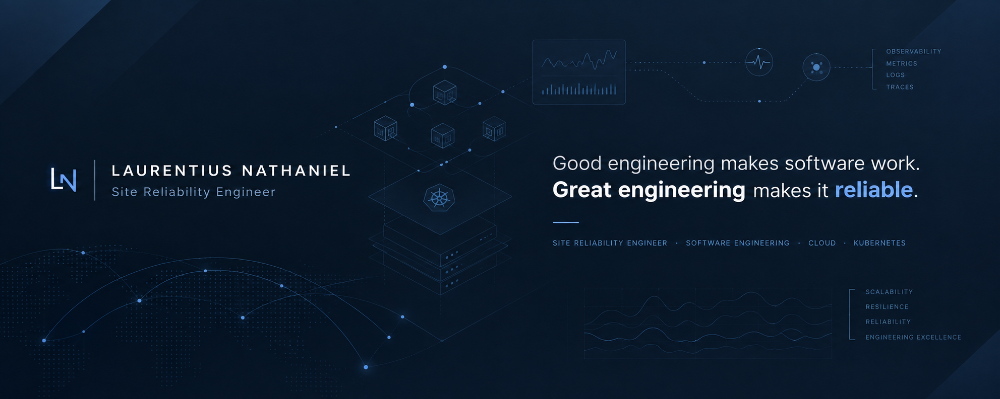

  

  

  
  

  
  
  
  
  

---

## `$ whoami`

  

> 🎯 **Mission:** build scalable, reliable infrastructure with a strong focus on developer experience, so teams can ship software faster and with confidence.

## ⚡ From Commit to Production

  

## 🏆 Impact Highlights

<table>
<tr>
<td width="50%" valign="top">

### ☸️ Platform at Scale
- Run **100+ microservices** across **multi-cluster Kubernetes** with regular, low-risk upgrades
- Led **zero-downtime migrations** of microservices and **PostgreSQL** across clusters
- Migrated from **sidecar to Istio Ambient Mesh**, cutting per-pod overhead
- Hardened **Gateway API** to standardize ingress traffic management

</td>
<td width="50%" valign="top">

### 🚀 Developer Experience & Delivery
- Built custom **CI/CD pipelines** across the full SDLC with **GitOps (Argo CD)**
- Self-hosted **GitHub Actions runners on Kubernetes** for cheaper, faster builds
- **Terraform + Atlantis** workflows with safe state changes across production
- **AI-assisted automation** and custom AI agents that speed up debugging and ops

</td>
</tr>
<tr>
<td width="50%" valign="top">

### 📈 Reliability & Observability
- Replaced a legacy stack with **VictoriaMetrics** and an org-wide **Grafana** baseline
- Built an end-to-end **CDN logging pipeline** with a log ingester written in **Go**
- Operated **Kafka** clusters with dedicated monitoring
- On-call incident response and fast root-cause analysis with dev teams

</td>
<td width="50%" valign="top">

### 🔐 Security & Cost
- Rolled out a **company-wide mesh VPN** for secure cross-environment access
- Least-privilege pods via **IRSA / Workload Identity**
- Layered defense: **WAF**, security groups, **Kubernetes network policies**
- **FinOps**: rightsized workloads and reduced cloud spend across clusters

</td>
</tr>
</table>

## 🛠️ Tech Arsenal

**☁️ Cloud & Compute**

  
  

**☸️ Containers & Orchestration**

  
  

**🔁 CI/CD, GitOps & IaC**

  
  
  

**🌐 Networking & Traffic**

  
  
  
  

**📈 Observability**

  
  
  
  
  

**🗄️ Data & Messaging**

  
  

**🔐 Security**

  
  
  
  

**💻 Languages & Scripting**

  
  

## 🗺️ Journey

  

## 📊 GitHub Telemetry

  
  

  

  

  <picture>
    <source media="(prefers-color-scheme: dark)" srcset="https://raw.githubusercontent.com/launathiel/launathiel/output/github-snake-dark.svg" />
    <source media="(prefers-color-scheme: light)" srcset="https://raw.githubusercontent.com/launathiel/launathiel/output/github-snake.svg" />
    
  </picture>

